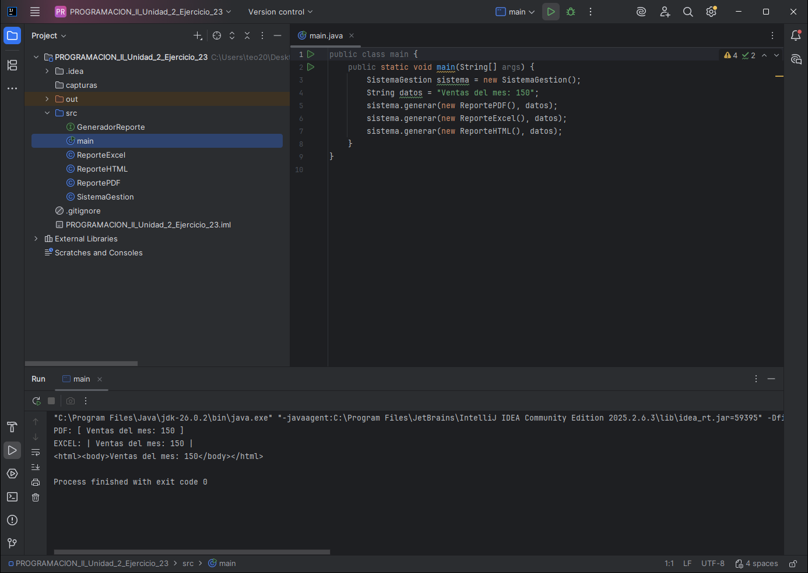

# PROGRAMACIÓN II — Unidad 2, Ejercicio 23: Generación de Reportes en Múltiples Formatos

Trabajo práctico de Programación II. Este repositorio contiene la resolución en Java del ejercicio 23 de la Unidad 2.

## Consigna

#### Contexto

En los sistemas de gestión empresarial, la información procesada debe exportarse a diversos formatos (PDF, Excel, HTML) según los requerimientos del usuario. La modularidad permite que el motor de generación de reportes delegue la tarea de formato a componentes especializados sin modificar la lógica de negocio central.

#### Consigna

Construir una solución en Java donde el generador de reportes utilice una interfaz abstracta para producir salidas en diferentes formatos de manera modular.

#### Desarrollo requerido

- Definir una clase abstracta o interfaz GeneradorReporte que contenga el método exportar(String contenido).
- Implementar clases concretas como ReportePDF, ReporteExcel y ReporteHTML que sobrescriban el método con la simulación del formato correspondiente.
- Crear una clase coordinadora SistemaGestion que utilice la abstracción del reporte para procesar la información.
- En el método main, instanciar distintos tipos de generadores y ejecutar la exportación de un conjunto de datos, mostrando los resultados formateados por consola.

## Estructura del repositorio

```
PROGRAMACION_II_Unidad_2_Ejercicio_23/
├── README.md
├── capturas/
│   └── consola.png
└── src/
    ├── GeneradorReporte.java
    ├── main.java   # clase con el método main
    ├── ReporteExcel.java
    ├── ReporteHTML.java
    ├── ReportePDF.java
    └── SistemaGestion.java
```

## Funcionamiento y lógica

El ejercicio usa una **interfaz** para generar un mismo reporte en distintos formatos sin que el sistema dependa de cada uno.

### `GeneradorReporte` (interfaz)

Define el método `void exportar(String contenido)`.

### `ReportePDF`, `ReporteExcel` y `ReporteHTML`

Implementan la interfaz, y cada uno da formato al contenido a su manera:

- **PDF:** `PDF: [ contenido ]`
- **Excel:** `EXCEL: | contenido |`
- **HTML:** `<html><body>contenido</body></html>`

### `SistemaGestion`

Su método `generar(GeneradorReporte generador, String datos)` recibe cualquier generador y le pide que exporte los datos. No sabe qué formato está usando: eso lo resuelve el polimorfismo.

### `main`

Con el texto "Ventas del mes: 150", le pide al sistema que genere el reporte en los tres formatos, y cada uno se imprime con su propio formato.

## Ejecución

Captura de la consola de IntelliJ IDEA ejecutando el programa:



Salida obtenida:

```
PDF: [ Ventas del mes: 150 ]
EXCEL: | Ventas del mes: 150 |
<html><body>Ventas del mes: 150</body></html>
```
